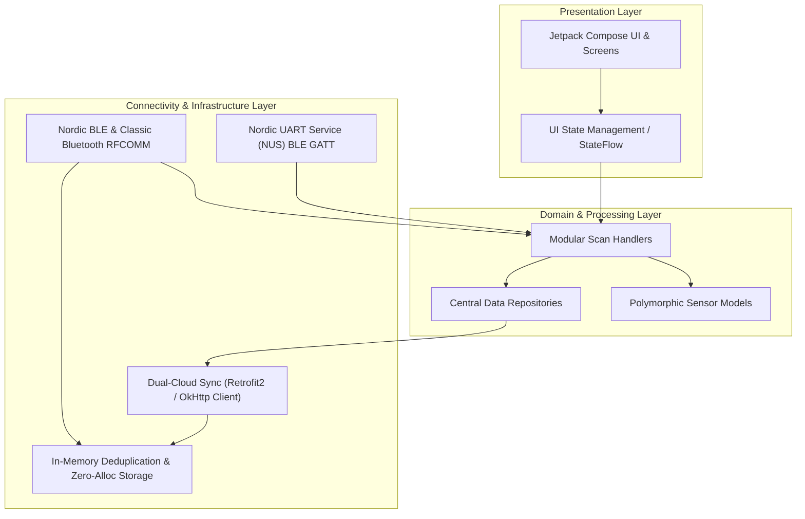
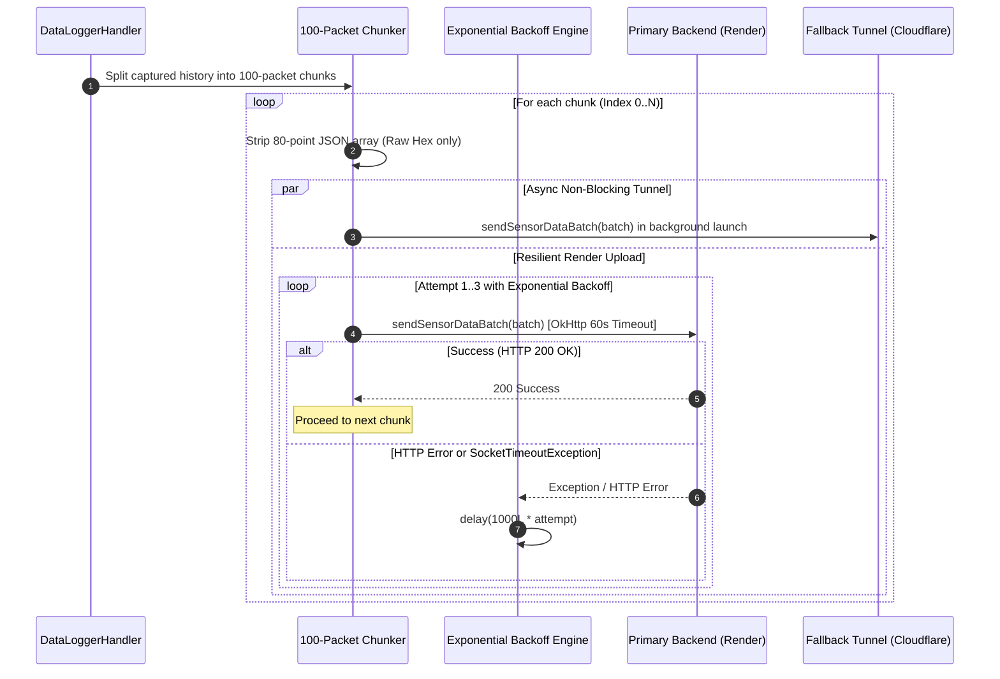
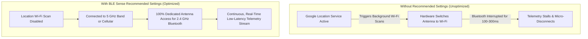

# BLESense Master Application Architecture & Operational Guide

Welcome to the comprehensive technical documentation for the **BLESense** Android Application. This guide details the complete system architecture, data flow pipelines, Bluetooth communication protocols, Jetpack Compose UI logic, Cloud sync pipeline, and step-by-step operational workflows for all current production features.

---

## 📐 1. System Architecture Overview

The **BLESense** app is engineered using modern Android development best practices and follows a **Monolithic Single-Module Clean Architecture with Internal Package-Based Modularity**:

- **UI Framework**: 100% Jetpack Compose with Material 3, supporting dynamic dark and light mode themes.
- **Language**: Kotlin (Target: JDK 17 / Android 14+ API 34, Compile SDK 36).
- **Architecture Pattern**: MVVM (Model-View-ViewModel) with unidirectional data flow powered by Kotlin Coroutines, `StateFlow`, `SharedFlow`, and non-blocking channels.
- **Decoupled Scanning Engine**: All Bluetooth advertising parsing is strictly partitioned into isolated handlers implementing the `BleDeviceHandler` interface:
  - `SensorHubHandler`: Decodes SHT40, Sen66, BME680, LIS3DH, and multi-sensor environmental telemetry.
  - `AwsSensorHandler`: Decodes Autonomous Weather Station telemetry with live gauge analytics.
  - `DataLoggerHandler`: Implements high-throughput bundle-based triple-blast packet parsing, gap filling, BitSet tracking, zero-allocation buffer storage, and optimized cloud synchronization.
  - `StepCounterHandler`: Isolated LIS3DH pedometer engine featuring dynamic baseline gravity removal and hysteresis peak detection.
  - `RawTestDeviceHandler`: Inspects and exposes raw hexadecimal manufacturer-specific advertising payloads.
- **Cloud Synchronization Pipeline**:
  - `RetrofitClient` / `BackendService`: Features high-resilience OkHttp configuration with 60-second timeouts (`connectTimeout`, `readTimeout`, `writeTimeout`) and automatic connection retries to withstand cloud cold starts and network latency.
  - `DataLoggerHandler Upload Pipeline`: Sends 100-packet chunks with raw hex payload optimization (~85% data & RAM savings), 3-attempt exponential backoff retry loops, and non-blocking background tunnel dispatch.
- **Dual-Mode Robot Controller**:
  - **Classic Bluetooth (SPP)**: RFCOMM socket communication for legacy modules (HC-05, HC-06).
  - **Bluetooth Low Energy (BLE)**: Nordic UART Service (NUS) with high-speed GATT write pipelines.
  - **Live Over-The-Air Discovery**: Strictly isolates live physical RF inquiries (`ACTION_FOUND` & `onScanResult`), rejecting offline bonded device caches.
  - **Mutex Concurrency**: ReentrantLock-based write mutex to eliminate command collisions and buffer saturation.
  - **Safety Stop Protocol**: Instant zero-velocity stop packet dispatch upon back navigation, app backgrounding, or disconnection.
- **BLE Interactive Game Suite**:
  - Proximity-based Marvel Avengers-themed games (Single Player, Guess Character, Bomb Defusal, Multiplayer).
  - Powered by `BleGameViewModel` and `BleGameRepository`.
- **Navigation**: Jetpack Compose Navigation (`NavHost` & `NavHostController`) with strict typed back-stack handling and insets awareness.

```
                              ┌───────────────────────────────────┐
                              │            MainActivity           │
                              └─────────────────┬─────────────────┘
                                                │
                                       ┌────────┴────────┐
                                       │   NavHost UI    │
                                       └────────┬────────┘
                                                │
        ┌───────────────┬───────────────────────┼───────────────────────┬───────────────┐
        ▼               ▼                       ▼                       ▼               ▼
 ┌──────────────┐┌──────────────┐       ┌──────────────┐        ┌──────────────┐┌──────────────┐
 │ Intermediate ││ AWS Scanner  │       │ Home Screen  │        │ Step Counter ││ Robot Control│
 │ (Dashboard)  ││ (Weather)    │       │ (Sensor Hub) │        │ (LIS3DH Hub) ││ (HUD Drive)  │
 └──────────────┘└──────────────┘       └──────────────┘        └──────────────┘└──────────────┘
        │               │                       │                       │               │
        │       ┌───────┴───────────────────────┴───────────────────────┴───────┐       │
        │       │                                                               │       │
        ▼       ▼                                                               ▼       ▼
 ┌──────────────┐┌──────────────┐                                       ┌──────────────┐┌──────────────┐
 │ Data Logger  ││ Game Suite   │                                       │ BigAdv Scan  ││ Settings     │
 │ (Acquisition)││ (Marvel BLE) │                                       │ (BLE 5.0)    ││ (RF & Power) │
 └──────────────┘└──────────────┘                                       └──────────────┘└──────────────┘
        │               │                                                       │       │
        └───────────────┴───────────────────────┬───────────────────────────────┴───────┘
                                                │
                                     ┌──────────┴──────────┐
                                     │ BluetoothViewModel  │
                                     └──────────┬──────────┘
                                                │
                 ┌──────────────────────────────┼──────────────────────────────┐
                 ▼                              ▼                              ▼
      ┌────────────────────┐         ┌────────────────────┐         ┌────────────────────┐
      │  BLE Scan Router   │         │  Targeted Trigger  │         │ Dual-Mode Robot Hub│
      │ (Channel Pipeline) │         │  (Advertise Mode)  │         │ (RFCOMM & NUS GATT)│
      └──────────┬─────────┘         └────────────────────┘         └────────────────────┘
                 │
      ┌──────────┼──────────────────────┬──────────────────────┬──────────────────────┐
      ▼          ▼                      ▼                      ▼                      ▼
┌───────────┐┌───────────┐        ┌───────────┐          ┌───────────┐          ┌───────────┐
│ SensorHub ││ AWS       │        │DataLogger │          │StepCounter│          │  RawTest  │
│ Handler   ││ Handler   │        │Handler    │          │Handler    │          │  Handler  │
└───────────┘└───────────┘        └───────────┘          └───────────┘          └───────────┘
```

---

## 🏗️ 2. App Modular Architecture (Internal Layers)



### 1. Presentation Layer (`view`, `viewmodel`)
- **View**: Declarative composable screens with full edge-to-edge support, custom Canvas rendering, HUD dials, and animated status meters.
- **ViewModel**: Preserves state across configuration changes, manages Coroutine scopes (`viewModelScope`), and exposes read-only `StateFlow` streams.
- **Theme Support**: Centralized in `BleSenseColors` and `ThemeManager` with system-aware automatic palette switching.

### 2. Domain & Data Layer (`model`, `repository`, `viewmodel/handler`)
- **SensorData**: Sealed class hierarchy providing type safety for `AWSData`, `SHT40`, `Sen66`, `LIS3DH`, `DataLoggerData`, and `StepCounterData`.
- **BleDeviceHandler**: Pluggable interface (`canHandle` & `handle`) ensuring handlers remain completely decoupled and testable.

### 3. Infrastructure & Network Layer (`util`, `api`, network, Bluetooth)
- Hardware abstractions for Classic Bluetooth RFCOMM serial streams, BLE LE Scanners, and NUS GATT client connections.
- **Dual-Cloud API Integration**: `RetrofitClient` orchestrates Retrofit2 and custom OkHttp instances targeting Render primary endpoints and Cloudflare tunnels.

---

## 🌐 3. Cloud Data Upload & Dashboard Sync Pipeline

The Data Logger feature includes an enterprise-grade cloud synchronization engine designed for zero-data-loss transmission over unstable mobile networks:



### Key Optimization Metrics & Enhancements:

1. **Extended OkHttp Timeouts (60 Seconds)**:
   - Customized `OkHttpClient` with 60s `connectTimeout`, `readTimeout`, `writeTimeout`, and `.retryOnConnectionFailure(true)`.
   - Prevents `SocketTimeoutException` during Render cloud instance cold starts or network latency spikes (12–15 seconds).
2. **Payload Optimization (~85% Cellular Data & Memory Reduction)**:
   - Omits pre-mapped 80 XYZ point arrays from JSON payload.
   - The backend decodes points on demand directly from `rawDataHex`.
   - Reduces packet payload size from **~3.5 KB to ~0.55 KB**, shrinking a 10,000-packet upload from 35 MB to 5.5 MB and eliminating Android ART Garbage Collection (GC) pauses.
3. **Chunk Size Optimization (100 Packets/Batch)**:
   - Doubled batch size from 50 to 100 packets, cutting HTTP connection overhead and total request roundtrips in half.
4. **Exponential Backoff Retry Engine (3 Attempts)**:
   - Retries failed chunks up to 3 times with progressive delays (`1s`, `2s`, `3s`) before moving forward, guaranteeing zero dropped packets.
5. **Decoupled Fallback Tunnels**:
   - Cloudflare tunnel requests are executed in a non-blocking background `launch` block, ensuring expired or unresponsive tunnels never block or slow down the primary Render upload stream.

---

## 📁 4. Key File Directory & Responsibilities

| File Path | Core Responsibility |
| :--- | :--- |
| `MainActivity.kt` | Application entry point; initializes edge-to-edge insets, splash screen, and permissions. |
| `Navigation.kt` | Master `NavHost` configuring all 15+ screen routes with typed argument passing. |
| `BackendService.kt` | Retrofit2 API interface and `RetrofitClient` singleton with custom 60-second OkHttp configuration. |
| `BluetoothScanViewModel.kt` | Central scan router; coordinates scanning channels, targeted advertising triggers, and delegates to handlers. |
| `StepCounterScreen.kt` | Real-time pedometer screen; renders 3D progress ring, cadence/distance/calories cards, and 3-axis accelerometer telemetry. |
| `StepCounterHandler.kt` | Isolated handler for LIS3DH Step Counter devices; processes dynamic baseline gravity and hysteresis peak detection. |
| `StepCounter.kt` | Pocket-optimized algorithmic step engine; calculates cadence, motion amplitude, and debounced step events. |
| `RobotControlCompose.kt` | Dual-mode Robot Car HUD; features 3D steering dials, live-only RF inquiry scanning, and thread-safe safety stops. |
| `DataLoggerScreen.kt` | High-speed data acquisition screen; monitors triple-blast bundle progress, gap filling, and BitSet tracking. |
| `DataLoggerHandler.kt` | Decodes high-speed accelerometer burst bundles, detects blast retry rounds, and executes resilient cloud batch uploads. |
| `SensorHubHandler.kt` | Multi-sensor environmental decoder for SHT40, Sen66, BME680, and LIS3DH nodes. |
| `AwsSensorHandler.kt` | Autonomous Weather Station telemetry decoder; exposes live temperature, humidity, wind, and rain metrics. |
| `AWSScannerScreen.kt` | Real-time weather station dashboard with animated gauge needles and cloud sync controls. |
| `BleGameViewModel.kt` | State manager for proximity-based Marvel Avengers BLE games. |
| `GameplayScreen.kt` | Interactive single-player BLE game interface displaying hero animations, proximity meters, and point scores. |
| `BombDefusalScreen.kt` | Timed proximity bomb defusal screen using real-time RSSI signal strength thresholds. |
| `SettingsPage.kt` | Comprehensive configuration hub; provides Wi-Fi 2.4 GHz coexistence settings, battery optimization guidance, and theme toggles. |
| `RawDataViewerScreen.kt` | Live hexadecimal packet viewer for deep RF diagnostics and manufacturer data inspection. |
| `BleSenseColors.kt` | Design tokens for high-contrast light and obsidian dark modes. |

---

## 📡 5. Bluetooth Communication & Hardware Protocols

### A. DataLogger Bundle-Based Triple-Blast Protocol

The DataLogger firmware transmits high-frequency accelerometer logs using extended BLE advertising bundles:
1. **Packet Structure (246 bytes)**:
   - `Mfg[0-1]`: Unique Packet ID (16-bit little-endian)
   - `Mfg[2]`: Node ID (8-bit)
   - `Mfg[3-242]`: Accelerometer payload (80 $X, Y, Z$ data points)
   - `Mfg[243-244]`: Total packet count (16-bit little-endian)
   - `Mfg[245]`: Extra padding and blast metadata
2. **Bundle Sizing**: 6 packets per bundle. Starting packet ID determines `bundleId`:
   $$\text{bundleId} = \text{packetId} - ((\text{packetId} - 1) \pmod 6)$$
3. **Triple Blast Retry Logic**:
   - Each bundle is advertised sequentially up to 3 times to guarantee delivery over lossy RF channels.
   - Blast round increments are detected when identical `bundleId` arrives with $\ge 150\text{ ms}$ interval.
4. **BitSet Gap Filling**:
   - Received packet IDs are recorded in an in-memory `BitSet`.
   - Repeated packets in Rounds 2 & 3 are rejected to avoid duplicate counting.

---

### B. Step Counter (LIS3DH Pedometer Algorithm)

The Step Counter engine processes raw accelerometer broadcasts from LIS3DH sensor nodes:
1. **3D Acceleration Magnitude**:
   $$\text{Magnitude} = \sqrt{X^2 + Y^2 + Z^2}$$
   Ensures complete orientation independence whether the sensor is upright, sideways, or in a pocket.
2. **Dynamic Gravity Baseline Removal**:
   - Applies an adaptive low-pass filter to isolate Earth's static $1g$ gravity component:
     $$\text{Baseline}_{t} = \alpha \cdot \text{Baseline}_{t-1} + (1 - \alpha) \cdot \text{Magnitude}_t$$
   - Dynamic motion component: $\text{Motion} = \lvert \text{Magnitude} - \text{Baseline} \rvert$.
3. **Hysteresis Zero-Crossing Peak Detector**:
   - Confirms a step event when motion crosses the adaptive peak threshold ($\ge 0.45\text{ m/s}^2$) and returns to valley baseline ($\le 0.10\text{ m/s}^2$) or drops by $\ge 60\%$.
   - **Debounce Window**: $260\text{ ms}$ refractory period limits maximum cadence to $\sim 230\text{ SPM}$, rejecting harmonic foot-strike noise.
4. **Real-Time Telemetry**:
   - Calculates Cadence (Steps/min), Estimated Distance ($\approx 0.75\text{ m/step}$), and Energy Expenditure ($\approx 0.04\text{ kcal/step}$).

---

### C. Dual-Mode Robot Car Control (Classic SPP + BLE NUS)

1. **Dual Connectivity**:
   - **Classic SPP**: Connects via `BluetoothSocket` using standard Serial Port Profile UUID (`00001101-0000-1000-8000-00805F9B34FB`).
   - **BLE NUS**: Connects via `BluetoothGatt` using Nordic UART Service (`6E400001-...`):
     - **RX Characteristic**: `6E400002-...` (Write without response)
     - **TX Characteristic**: `6E400003-...` (Notifications)
2. **Strict Live Over-The-Air Discovery Filter**:
   - Devices are **only** displayed in the connection dialog if active radio inquiry packets (`BluetoothDevice.ACTION_FOUND`) or live BLE advertising packets (`onScanResult`) are received in the current session.
   - Cached local paired devices (`bondedDevices`) and disk cache broadcasts (`ACTION_UUID`) are rejected so offline devices never appear.
3. **Mutex-Locked Concurrency & Safety Stops**:
   - `ReentrantLock` write mutex prevents concurrent transmission collisions.
   - Non-blocking conflated dispatch ensures the most recent command is always transmitted without buffer bloat.
   - **Immediate Stop**: Sends `S` (Movement Stop) and `C` (Steering Center) immediately when the control dial is released, the screen is dismissed, or connection drops.

---

### D. BLE Interactive Game Suite

1. **Proximity Signal RSSI Mapping**:
   - Converts real-time BLE RSSI values into distance estimates:
     $$d = 10^{\frac{\text{Measured Power} - \text{RSSI}}{10 \cdot n}}$$
2. **Game Mechanics**:
   - **Character Guessing**: Scans nearby BLE device IDs and challenges the user to match physical beacons with Marvel hero profiles.
   - **Bomb Defusal**: Requires players to maintain close physical proximity (strong RSSI threshold $\ge -60\text{ dBm}$) while solving timed puzzle sequences.
   - **Multiplayer**: Synchronizes scores and target beacon discoveries across multiple players.

---

## ⚡ 6. Physical Hardware & RF Coexistence Testing

### 2.4 GHz Antenna Isolation Flow



### Samsung One UI Battery Optimization Profile

| Battery Configuration | Background Policy | Radio Connection Result | Operational Recommendation |
| :--- | :--- | :--- | :--- |
| **❌ Sleeping / Deep Sleep** | OS terminates process after 60 min | Connection drops when phone screen turns off | 🚫 Prohibited for live logging |
| **⚠️ Optimized (Default)** | OS throttles Bluetooth polling intervals | Periodic packet pauses during idle states | ⚠️ Causes telemetry jitter |
| **✅ Unrestricted (Recommended)**| Continuous background execution | **100% Uninterrupted Live Telemetry Stream** | 🟢 Required for enterprise testing |

---

## 🚀 7. Build & Deployment Specifications

- **Compile SDK**: `36` (Android 16 / Extension 15)
- **Target SDK**: `36` (Android 16)
- **Min SDK**: `29` (Android 10)
- **Version Code**: `25`
- **Version Name**: `1.2.4`
- **Key Dependencies**:
  - `androidx.compose.material3`: Material 3 Compose system.
  - `com.squareup.retrofit2:retrofit` & `converter-gson`: Dual-cloud REST API sync.
  - `com.squareup.okhttp3:okhttp`: Custom OkHttp client with 60s timeouts & retries.
  - `no.nordicsemi.android.kotlin.ble`: High-performance Nordic BLE scanner & GATT library.
  - `io.coil-kt:coil-compose` & `coil-gif`: Animated GIF and image rendering.
  - `androidx.navigation:navigation-compose`: Type-safe navigation.
- **ProGuard / R8**: Full optimization enabled with preserved serialization models (`@Keep`) for release builds.

---

*Document updated for BLESense Android Master Architecture & Network Pipeline v2.1*
